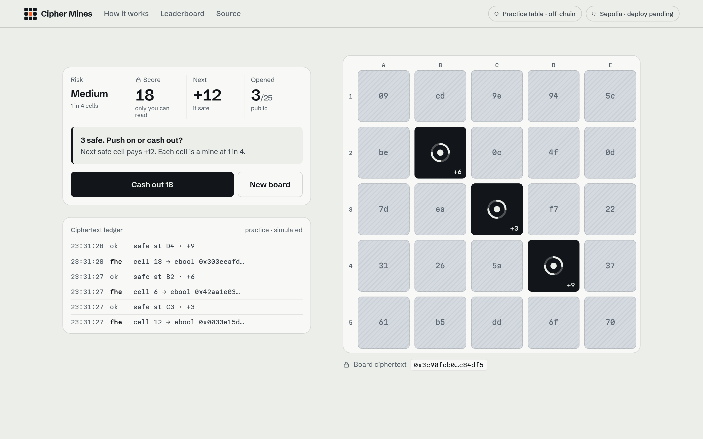
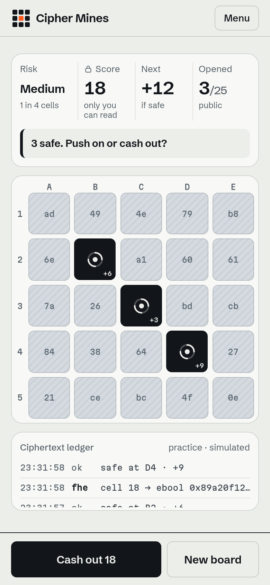

# Cipher Mines

**A minefield nobody can see.** A push-your-luck game on the [Zama Protocol](https://docs.zama.org) where the mine map
is drawn with encrypted on-chain randomness and stays sealed from the player, the deployer and every block explorer
until the round is settled.

Built for the Zama Developer Program, Mainnet Season 5: Confidential Gaming.





## The game

1. **Pick a risk level** and seal a board. A 5 × 5 grid gets its mines from `FHE.randEuint32()`.
2. **Open cells one by one.** The k-th safe cell pays `points × k`, so every step is worth more than the last.
3. **One mine wipes the round.** The score drops to zero under encryption.
4. **Cash out whenever you like.** Your score and the full mine map are publicly decrypted by Zama's KMS, the decryption
   proof is checked on-chain, and verified scores go to the leaderboard.

| Risk   | Mine odds per cell | Points per step |
| ------ | ------------------ | --------------- |
| Low    | 1 in 8             | × 1             |
| Medium | 1 in 4             | × 3             |
| High   | 3 in 8             | × 6             |

## Why it needs FHE

On a transparent chain the mine map would sit in contract storage, so anyone could read it and walk a perfect path. A
commit-reveal scheme would only move the problem: whoever generates the board knows it. Cipher Mines keeps every piece
of hidden state encrypted:

| State         | Type                | Who can read it during the round | How                                                                 |
| ------------- | ------------------- | -------------------------------- | ------------------------------------------------------------------- |
| Mine map      | `euint32` (25 bits) | **Nobody**                       | Only the contract is on the ACL (`FHE.allowThis`)                   |
| Step outcome  | `ebool`             | Only the player                  | `FHE.ne(FHE.and(board, bit), 0)`, then `FHE.allow(lastHit, player)` |
| Running score | `euint32`           | Only the player                  | `FHE.select(aliveAfter, score + reward, 0)`                         |
| Alive flag    | `ebool`             | Only the player                  | `FHE.and(alive, FHE.not(isMine))`                                   |
| Cells chosen  | `uint32` bitmap     | Everyone                         | Public by design, so a bad step can't be re-rolled                  |
| Final result  | public decryption   | Everyone, after cash-out         | `FHE.makePubliclyDecryptable` + `FHE.checkSignatures`               |

## Fairness

- **On-chain randomness.** Mines come from `FHE.randEuint32()`. Density is set by combining independent random words:
  `a & b & c` (1/8), `a & b` (1/4), `a & (b | c)` (3/8). The odds are public; the result is not.
- **Nobody can peek.** The board handle is only on the contract's ACL. The player cannot decrypt it (there is a test for
  this), and neither can the deployer.
- **Choices are committed.** Each `openCell` is a transaction, so a player cannot try a cell, see the outcome and undo
  it.
- **Anyone can audit a round.** `cashOut()` marks score and map publicly decryptable. `settle()` accepts the cleartexts
  only with a valid KMS decryption proof, records the map on-chain, and any player can check that every outcome they saw
  matches it. The frontend runs this check automatically.
- **Anyone can settle.** `settle(player, …)` is permissionless, so a round can't be left hanging.

## Repository

```
contracts/CipherMines.sol    game contract (FHEVM)
test/CipherMines.ts          11 tests in FHEVM mock mode
deploy/deploy.ts             hardhat-deploy script (localhost / Sepolia)
tasks/CipherMines.ts         CLI tasks: address, leaderboard, play a full round
frontend/                    React + Vite app using @zama-fhe/relayer-sdk
docs/                        demo video script, X post, Sepolia guide
```

Based on the official [fhevm-hardhat-template](https://github.com/zama-ai/fhevm-hardhat-template).

## Run it

```bash
npm install
npm run compile
npm test                      # 11 passing, FHEVM mock mode
```

Play a full round on a local node:

```bash
npx hardhat node --no-deploy           # terminal 1
npx hardhat deploy --network localhost # terminal 2
npx hardhat --network localhost mines:play --risk 1 --cells 12,6,18
```

Frontend:

```bash
cd frontend
npm install
npm run dev                   # practice table works with no wallet
VITE_CONTRACT_ADDRESS=0x... npm run build   # Sepolia build
```

The practice table runs the same rules in the browser so anyone can try the game without a wallet. It is clearly
labelled as off-chain. With `VITE_CONTRACT_ADDRESS` set, "Play on Sepolia" connects a wallet, uses the relayer SDK for
user decryption (one EIP-712 signature per session) and public decryption, and settles on-chain.

## Deploy to Sepolia

See [docs/SEPOLIA.md](docs/SEPOLIA.md).

```bash
npx hardhat vars set MNEMONIC
npx hardhat vars set INFURA_API_KEY
npm run deploy:sepolia
npx hardhat --network sepolia mines:play
```

## Contract API

| Function                                  | What it does                                                       |
| ----------------------------------------- | ------------------------------------------------------------------ |
| `startRound(Risk)`                        | Seals a new encrypted board, resets encrypted score and alive flag |
| `openCell(uint8)`                         | Computes the encrypted outcome and score for one cell              |
| `cashOut()`                               | Makes score and board publicly decryptable                         |
| `settle(player, cleartexts, proof)`       | Verifies the KMS proof, records score and map, updates leaderboard |
| `getRound(player)` / `getHandles(player)` | Public round data / encrypted handles                              |
| `getLeaderboard()`                        | Top 10 verified scores                                             |

## Frontend hardening

The frontend is a static dApp with no backend, so only the layers that apply to a public web client are used.

| Layer                                                | Status  | What is done                                                                                                                                                                |
| ---------------------------------------------------- | ------- | --------------------------------------------------------------------------------------------------------------------------------------------------------------------------- |
| No secrets in the bundle                             | Applied | Only `VITE_CONTRACT_ADDRESS` (public) is read at build time. `scripts/post-build.mjs` fails the build on secret-like names, 64-hex strings, or source maps.                 |
| Minified, mangled production JS                      | Applied | Terser with top-level mangling, `console` and `debugger` stripped, comments removed, **no source maps** shipped to Pages.                                                   |
| Content-Security-Policy                              | Applied | Meta CSP injected at build: `default-src 'none'`, scripts and fonts from `'self'`, `connect-src` limited to Zama's relayer and its key bucket, no frames, objects or forms. |
| Subresource Integrity                                | Applied | sha384 `integrity` attribute on every built script and stylesheet. `dist/SHA256SUMS` lists a checksum for each build file.                                                  |
| Integrity of game results                            | Applied | The KMS decryption proof is verified on-chain (`FHE.checkSignatures`) before a result counts. This is the dApp equivalent of request signing.                               |
| LICENSE and brand note                               | Applied | See below.                                                                                                                                                                  |
| Backend isolation, HMAC-signed API calls             | Skipped | There is no server and no API secret. A key shipped to a browser would not be secret.                                                                                       |
| R8/ProGuard, RASP, SSL pinning, AES asset encryption | Skipped | Mobile-app layers; a web page cannot pin certificates or verify its own signature.                                                                                          |
| Control-flow obfuscation, anti-LLM decoys            | Skipped | The full source is public on GitHub by design, and heavy obfuscation risks breaking the WASM SDK. Decoys in contract code would only cost gas.                              |

Reduced-motion users get a still board. All animation, including the JS-driven ciphertext drift, stops with
`prefers-reduced-motion`.

Report a vulnerability through the contact form on [saddammalik.com](https://saddammalik.com). Please do not open a
public issue for one.

## Brand

Code is licensed as below. The name **Cipher Mines**, its 3 × 3 logo mark and the screenshots are not licensed for reuse
in a way that suggests your project is this one. Forks are welcome; rename them. Misuse of the name or mark can be
reported for takedown.

## License

BSD-3-Clause-Clear, inherited from the Zama template. Contract source is MIT (see SPDX header).
